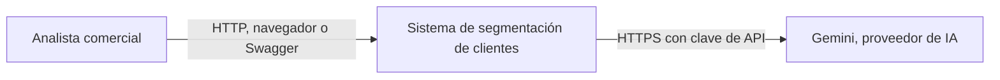
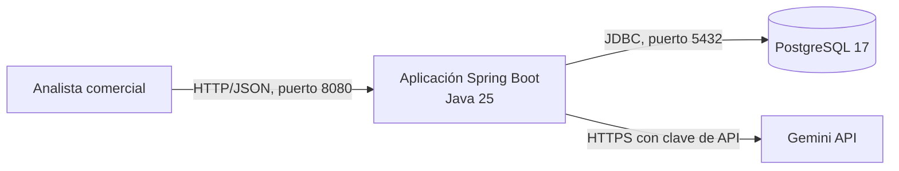

# Arquitectura

Sistema de segmentación de clientes del sector cosmético. Aplicación en capas
(presentación, negocio, infraestructura), con base de datos y proveedor de IA externos.

## Diagrama de contexto

El analista sube un CSV de compras y consulta los segmentos. El sistema usa
Gemini solo para redactar descripciones, con datos agregados.

## Diagrama de contenedores

La aplicación y la base de datos corren en Docker Compose. Swagger UI forma
parte de la aplicación.

## Decisiones de arquitectura
- [ADR-001: Java y Spring Boot](adr/ADR-001-stack.md)
- [ADR-002: PostgreSQL y Docker Compose](adr/ADR-002-base-de-datos.md)